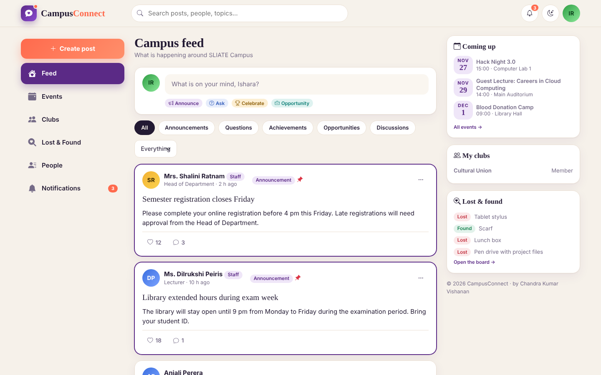
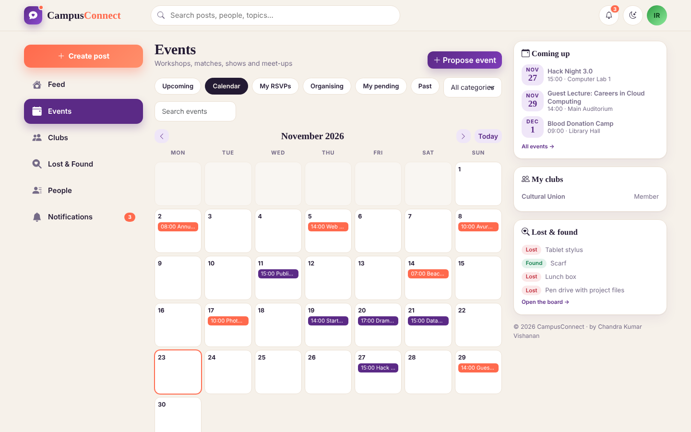
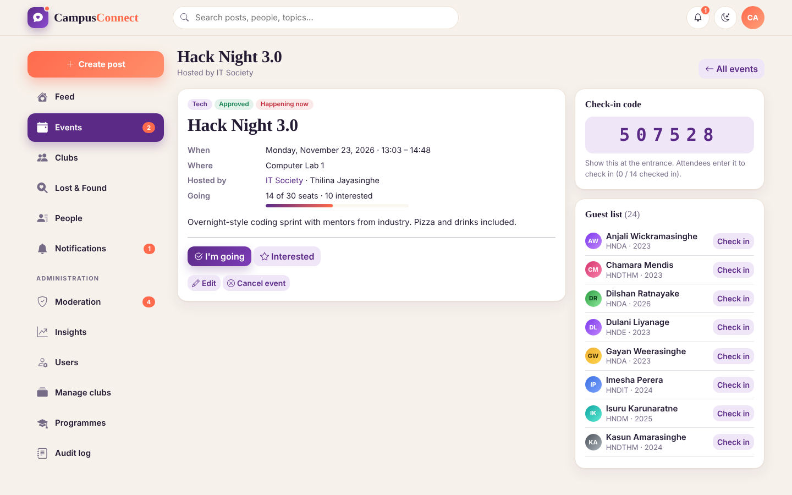
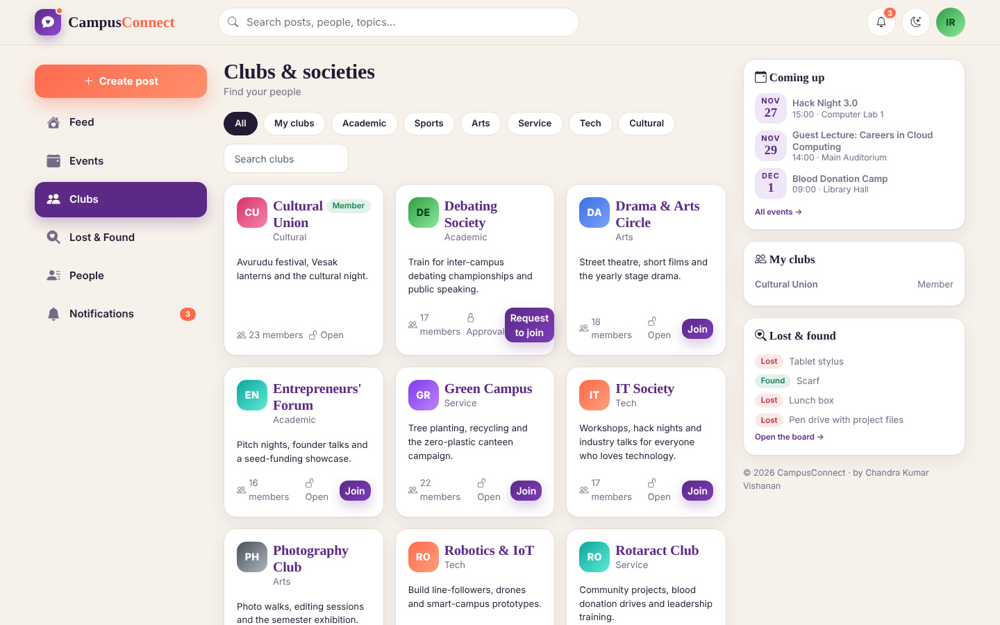
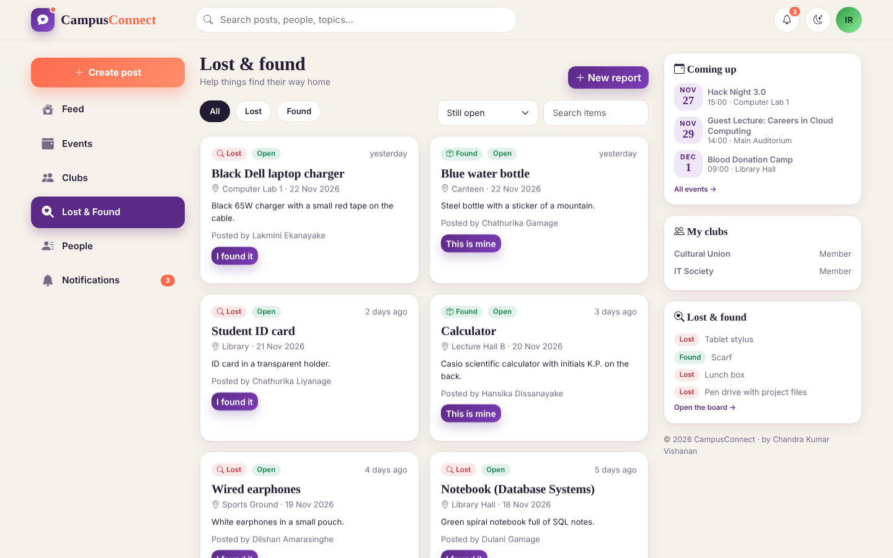
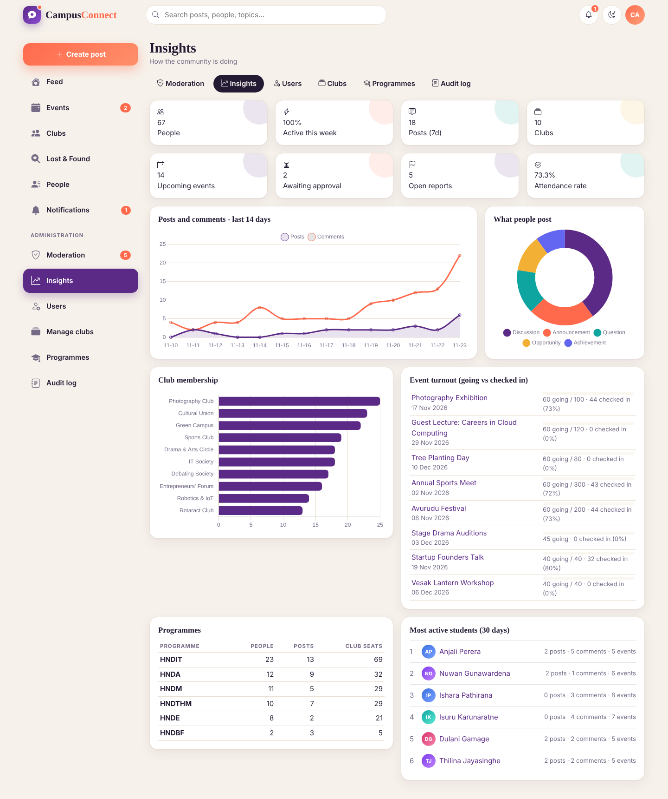
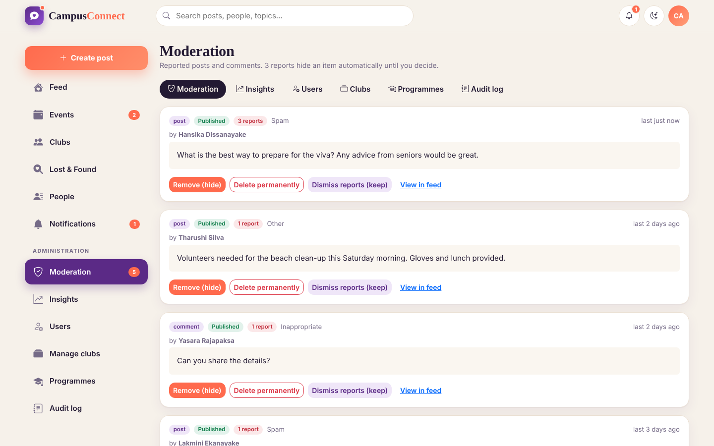
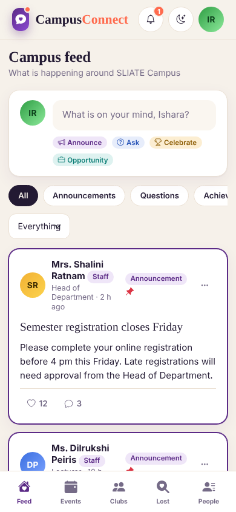
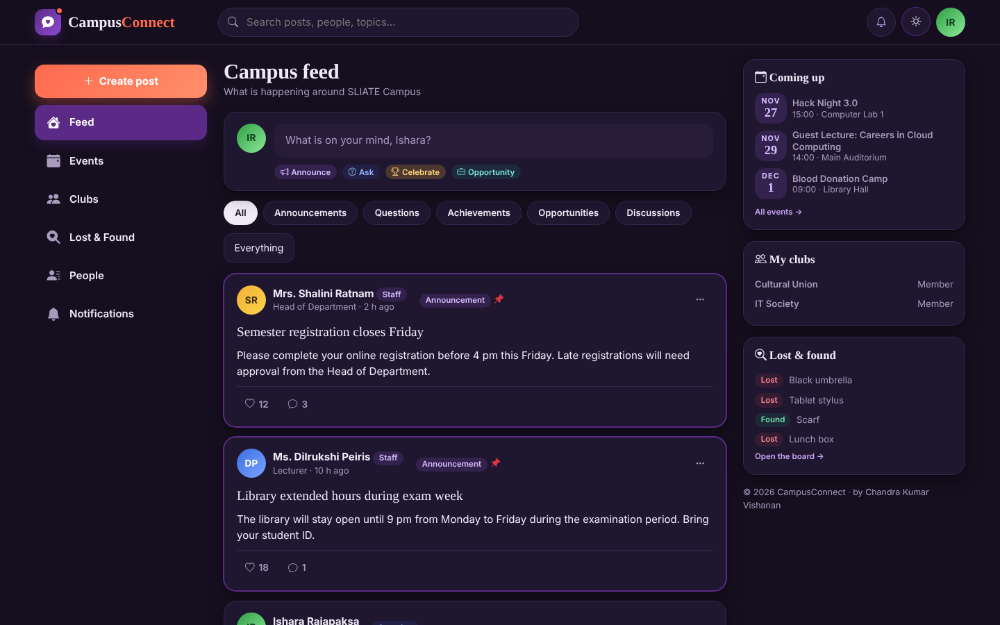
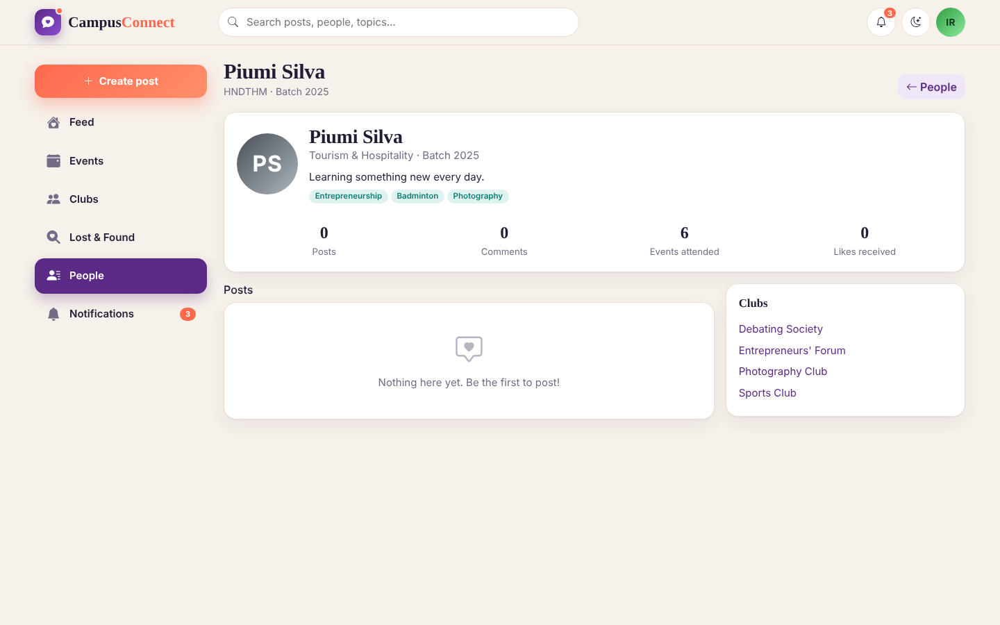

<div align="center">

# 🎓 CampusConnect

**The campus community hub** — feed and announcements, clubs and societies, events with RSVP and check-in, lost & found, a people directory, notifications and admin moderation.

   



</div>

## Overview

CampusConnect is the place where a college talks to itself. Lecturers publish **announcements** (optionally for one programme only), students post, ask questions and celebrate wins, **clubs** run their own pages and events, and everyone can **RSVP**, join a **waitlist** and **check in** with a code on the day. A **lost & found** board with a claim-and-confirm flow helps belongings find their owners, and administrators get a **moderation queue**, **event approvals** and **insight charts**.

Built with core PHP 8 + PDO, Bootstrap 5, vanilla JavaScript and Chart.js. No framework, no build step. Social 3-column layout, light/dark theme and a mobile bottom tab bar.

## Screenshots

| Events calendar | Event + check-in (organiser) | Clubs |
|---|---|---|
|  |  |  |

| Lost & found | Admin insights | Moderation queue |
|---|---|---|
|  |  |  |

| Mobile feed | Dark mode | Profile |
|---|---|---|
|  |  |  |

## Features

- **Feed** – posts, questions, achievements, opportunities and staff **announcements** with pinning (max 3), likes, comments, type filters, search, programme-targeted audiences and club posts.
- **Clubs & societies** – open or approval-based joining, one President per club, officers, advisor, member management, club page with posts, events and members.
- **Events** – categories, fixed venue list, calendar view, capacity and **waitlist with automatic promotion**, Going / Interested RSVPs, **overlap protection**, 6-digit **check-in code** or organiser check-in, admin **approval workflow**.
- **Lost & found** – Lost / Found reports → claim with a note → poster confirms or declines → contact details shared only with the two parties.
- **People** – searchable directory (name, interest, programme, role), public profiles with activity stats, self-service profile and password change.
- **Notifications** – comments, likes, approvals, waitlist promotions, cancellations, club requests, claims.
- **Moderation** – reports auto-hide an item after 3 distinct reporters; admins hide, delete or dismiss.
- **Admin** – insights (activity, post mix, club sizes, event turnout, programme stats, most active students), users, clubs, programmes, audit log.
- **Security** – CSRF tokens on every write, prepared statements, bcrypt passwords, role guards on every endpoint, output escaping.

## Roles

| Role | Can do |
|---|---|
| **Admin** | Everything: moderate, approve events, manage users, clubs and programmes, view insights and audit log |
| **Staff (lecturer)** | Publish and pin announcements, target a programme, create auto-approved events, advise clubs |
| **Student** | Post, comment, like, join clubs, RSVP, report content, lost & found; club officers post as the club and propose events |

## Business rules

**Posts** – Announcements are staff/admin only and need a title · max 3 pinned posts · audience by programme is staff/admin only · 10 s cooldown between posts · 3 distinct reports auto-hide a post or comment · students only see published posts for their programme (or everyone).

**Clubs** – Join policy *Open* (instant) or *Approval* (Pending until an officer decides) · at most 8 active clubs per student · exactly one President; a President cannot leave and must hand over the role first · managers = president, officers, advisor, admin.

**Events** – Staff events are auto-approved; student events are Pending until an admin approves (the approval re-checks venue clashes; rejection needs a reason) · must start ≥ 30 min ahead and ≤ 180 days ahead · max 12 hours, same day, finishing by 20:00 · no venue double-booking among approved events · a student editing the time/venue of an approved event sends it back to Pending.

**RSVP & check-in** – Going respects capacity, otherwise **Waitlist** · cannot be Going to two overlapping events · cancelling a Going RSVP promotes the oldest waitlisted person whose schedule has no clash · check-in opens 30 min before the start and closes 1 h after the end · 5 wrong codes lock the attendee out (the organiser can still check them in).

**Lost & found** – Open → Claim Pending (claim note 10–300 chars) → Resolved, or back to Open if declined · phone numbers are visible only to the poster and the claimant after confirmation · max 10 unresolved reports per user · date must be within the last 60 days.

## Demo logins

| Role | Username | Password |
|---|---|---|
| Admin | `admin` | `admin123` |
| Lecturers | `lecturer1` … `lecturer6` | `staff123` |
| Students | `student1` … `student60` | `student123` |

Handy ones: `student40` is President of IT Society, `student46` of Rotaract Club (approval-based joining), `student34` of Drama & Arts Circle. The seed uses dates relative to the import time, so the demo always looks current.

## Installation (WAMP)

1. Copy the folder to `C:/wamp64/www/campus_connect`.
2. Start WAMP, open **phpMyAdmin → Import** and import `sql/database.sql` (it creates the `campus_connect` database with sample data: 6 programmes, 10 clubs, 67 users, 40 posts, 27 events).
3. Check `config/config.php` (`DB_USER`, `DB_PASS`, `DB_PORT`; `APP_BASE` is `/campus_connect`).
4. Enable `mod_rewrite` (WAMP tray → Apache → Apache modules) and make sure `AllowOverride All` is on for `www`.
5. Open <http://localhost/campus_connect/> and sign in.

Fonts and libraries (Bootstrap, DataTables, Chart.js, flatpickr) load from CDNs, so the browser needs internet access.

## Tests

```bash
# fresh DB first (re-import sql/database.sql), then:
pip install requests
python3 tests/e2e_lifecycle.py          # 134 business-rule checks over HTTP
npm i playwright && npx playwright install chromium
node tests/ui_test.js                   # drives the UI and regenerates docs/screenshots/
```
Set `BASE`, `MYSQL` (e.g. `"C:/wamp64/bin/mysql/.../mysql.exe -uroot"`) and `DB_NAME` if your setup differs. The e2e test needs the `mysql` command-line client.

## Project structure

```
config/      settings + PDO connection
includes/    auth, helpers, header/footer, compose modal, models/ (Post, Club, Event, Lost, User, Notify, Insight …)
modules/     feed · events · clubs · lost · people · notify · admin   (page + api.php per module)
assets/      css/style.css (plum & coral theme, dark mode) · js/ (one file per page)
sql/         database.sql (schema + seed)
tests/       e2e_lifecycle.py · ui_test.js
docs/        screenshots
```

## Before going live

- Change every demo password and set `APP_DEBUG` to `false` in `config/config.php`.
- Serve over HTTPS and use a dedicated MySQL user instead of `root`.
- Notifications are in-app only; add e-mail/SMS delivery if you need it.
- Uploads (images/attachments) are intentionally not included.

## Author

**Chandra Kumar Vishanan**
HND in Information Technology (HNDIT) – SLIATE

## License

[MIT](LICENSE)
